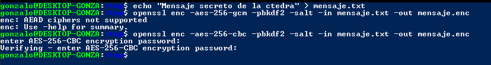
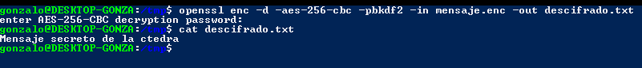
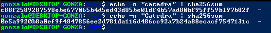
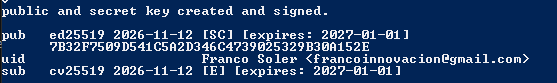
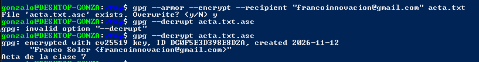

# Trabajo Práctico 6 — Criptografía aplicada

## Parte A — Simétrico y hash con OpenSSL

```bash
echo "Mensaje secreto de la catedra" > mensaje.txt
openssl enc -aes-256-gcm -pbkdf2 -salt -in mensaje.txt -out mensaje.enc
openssl enc -d -aes-256-gcm -pbkdf2 -in mensaje.enc -out descifrado.txt
cat descifrado.txt

echo -n "catedra" | sha256sum
echo -n "Catedra" | sha256sum
```

### Consigna A1

*Mostrá que `mensaje.enc` es ilegible y que se recupera el original.*

> **Importante**: El comando que se pide ejecutar no es válido. 

La técnica de AEAD no es compatible con la API de consola de openssl. Esto se evidencia en la siguiente captura.



Por lo tanto, en lugar de usar `-aes-256-gcm`, usaremos `-aes-256-cbc`, que no utiliza técnicas AEAD, pero sirve para continuar con la consigna.

- Salida de `cat mensaje.enc` (contenido binario ilegible): 


- Salida de `cat descifrado.txt` (debe coincidir con el original): 



El cifrado simétrico usa **la misma clave** (derivada de la passphrase
mediante PBKDF2) para cifrar y descifrar; sin esa passphrase el archivo no se puede
leer. [1][2]

### Consigna A2

*Compará los dos hashes SHA-256: cambiar una sola letra, ¿cuánto cambia el resultado?
¿Cómo se relaciona esto con la detección de integridad?*




- El resultado cambia **casi por completo**: es el **efecto avalancha**, propiedad de las funciones de hash criptográficas (un cambio mínimo en la entrada produce una salida totalmente distinta e impredecible). [3][4]
- Por eso un hash permite **detectar integridad**: si un solo bit del mensaje cambia, el hash cambia y la verificación falla. El hash no cifra ni permite recuperar el mensaje, solo actúa como huella digital. [3][4]

### Consigna A3

*¿Qué aporta el modo GCM frente a un modo de solo cifrado? (pista: AEAD).*

GCM es un modo **AEAD** (*Authenticated Encryption with Associated Data*): además de cifrar, genera una **etiqueta de autenticación** que permite detectar si el criptograma fue alterado. [5][6]
Un modo de solo cifrado (p. ej. CBC sin MAC) protege la confidencialidad pero no garantiza integridad/autenticidad: un atacante podría modificar el cifrado sin que el receptor lo note. [5][6]

---

## Parte B — Asimétrico y firma con GnuPG

```bash
gpg --full-generate-key
gpg --armor --export "Tu Nombre" > mi_publica.asc
echo "Acta de la clase 6" > acta.txt
gpg --armor --detach-sign acta.txt
gpg --verify acta.txt.asc acta.txt
```

### Consigna B1

*Mostrá la verificación exitosa de la firma. Después modificá `acta.txt` y volvé a
verificar: ¿qué pasa y por qué?*

- Verificación exitosa (pegar salida de `gpg --verify`):


- Modificación de `acta.txt`:

Modifiqué el texto de acta.txt para que diga "Clase 7" en vez de 6, y obtuve el siguiente mensaje


La firma se calcula sobre el **hash del documento**; al cambiar una palabra cambia el hash, por lo que la firma deja de corresponder y GnuPG informa `BAD signature`. [7][8]

### Consigna B2

*¿Con qué clave se firma y con cuál se verifica?*

- Se **firma con la clave privada** del firmante. [7][8]
- Se **verifica con la clave pública** del firmante. [7][8]
- Esto invierte el uso del cifrado asimétrico: lo que se cifra con una clave se descifra con la otra; en la firma, cualquiera con la pública puede comprobar que solo el dueño de la privada pudo firmar. [7][8]

### Consigna B3

*¿Qué tres propiedades de la Unidad 1 te da la firma digital?*

- **Autenticidad**: confirma la identidad del firmante (solo él tiene la privada). [7]
- **Integridad**: detecta cualquier cambio en el documento firmado. [7]
- **No repudio**: el firmante no puede negar haber firmado, porque solo él posee la clave privada. (legalmente, se requiere un certificado digital expedido por un certificante licenciado para que esto sea del todo cierto en Argentina) [7]

---

## Parte C — Cifrar para un destinatario

*Intercambiá claves públicas con un compañero (o generá una segunda clave de prueba).*

```bash
gpg --import compa_publica.asc
gpg --armor --encrypt --recipient "Nombre del Compa" acta.txt
gpg --decrypt acta.txt.asc
```

Generé una clave a nombre de Franco Soler (una demostración en vivo de por qué esto no tiene validez legal sin certificado!)



Sin embargo, no ocurrió lo que espera la consigna. Al haber creado yo el par de claves, también tengo la clave privada a disposición.



Pero haremos de cuenta que esto no pasó, que realmente recibí una clave pública de Franco para responder lo siguiente.

### Consigna C

*Explicá por qué vos, que cifraste el archivo, no podés descifrarlo con tu propia clave.
¿Con qué clave se cifró y con cuál se descifra?*


- El archivo se cifró con la **clave pública del destinatario**. [7][8]
- Solo se descifra con la **clave privada del destinatario**, que no tengo. [7][8]
- Mi clave privada no sirve porque el mensaje no fue cifrado para tu par de claves: la criptografía asimétrica garantiza que únicamente el destinatario pueda abrirlo (confidencialidad). [7][8]

---

## Parte D — Un certificado TLS real (PKI)

```bash
openssl s_client -connect www.unp.edu.ar:443 -servername www.unp.edu.ar </dev/null 2>/dev/null \
  | openssl x509 -noout -issuer -subject -dates

echo | openssl s_client -connect www.unp.edu.ar:443 -showcerts 2>/dev/null | grep -E "s:|i:"
```

### Consigna D1

*¿Quién emitió el certificado (issuer) y para quién (subject)? ¿Cuál es su período de
validez?*

- Issuer: `TODO`
- Subject: `TODO`
- `notBefore` / `notAfter`: `TODO`

<!-- Pegar la salida real de openssl x509. -->

### Consigna D2

*Identificá la cadena de confianza (servidor → intermedia → raíz).*

Puntos a explicar:

- El certificado del servidor lo emite una **CA intermedia**, que a su vez fue
  firmada por una **CA raíz** de confianza. [9][10]
- Cadena observada (pegar salida de `-showcerts` y marcar los `i:`/`s:`): `TODO`
- Cada eslabón está firmado por el anterior; la raíz es el ancla de confianza
  (*trust anchor*). [9][10]

### Consigna D3

*¿Por qué tu navegador confía en ese certificado sin haberlo visto antes?*

Puntos a explicar:

- Porque el navegador/sistema operativo trae una **lista de CA raíz de confianza**
  preinstalada. [9][10]
- Al validar la cadena hasta una de esas raíces, y comprobar firma, nombre del sitio
  (SAN) y vigencia, el certificado queda validado. [9][10]
- La confianza no está en el certificado en sí, sino en la **PKI** y en las CA que
  actúan como terceros de confianza. [9][10]

---

## Referencias

1. OpenSSL Project — `openssl enc`. https://docs.openssl.org/master/man1/openssl-enc/
2. OpenSSL Project — `EVP_EncryptInit` / modos de cifrado AEAD. https://docs.openssl.org/master/man3/EVP_EncryptInit/
3. NIST FIPS 180-4 — *Secure Hash Standard (SHS)* (2015). https://csrc.nist.gov/pubs/fips/180-4/upd1/final
4. Stallings, W. — *Cryptography and Network Security*, cap. sobre funciones hash y autenticación de mensajes.
5. NIST SP 800-38D — *Recommendation for Block Cipher Modes of Operation: GCM and GMAC* (2007). https://csrc.nist.gov/pubs/sp/800/38/d/final
6. RFC 5116 — *An Interface and Algorithms for Authenticated Encryption* (2008). https://www.rfc-editor.org/rfc/rfc5116
7. GnuPG — *The GNU Privacy Handbook*. https://www.gnupg.org/gph/en/manual.html
8. RFC 4880 — *OpenPGP Message Format* (2007). https://www.rfc-editor.org/rfc/rfc4880
9. RFC 5280 — *Internet X.509 Public Key Infrastructure Certificate and CRL Profile* (2008). https://www.rfc-editor.org/rfc/rfc5280
10. NIST SP 800-32 — *Introduction to Public Key Technology and the Federal PKI Infrastructure* (2001). https://csrc.nist.gov/pubs/sp/800/32/final
