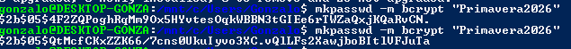
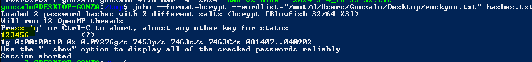
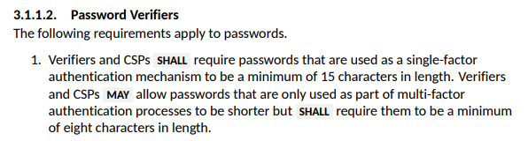
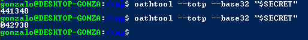
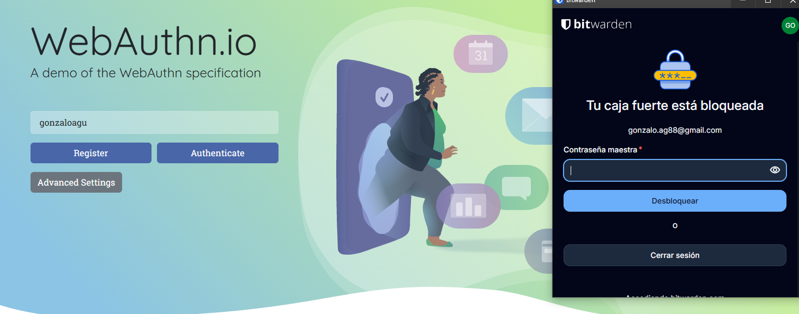
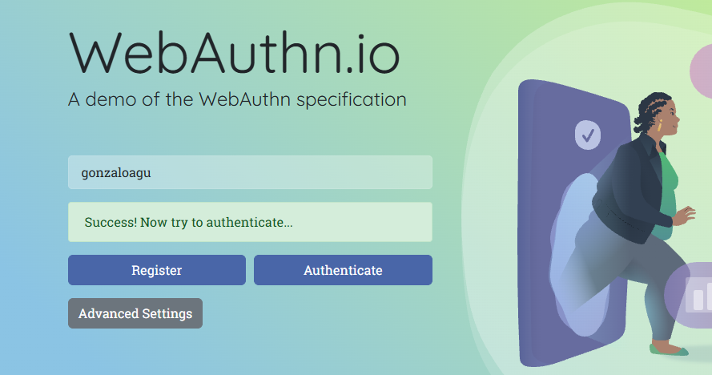
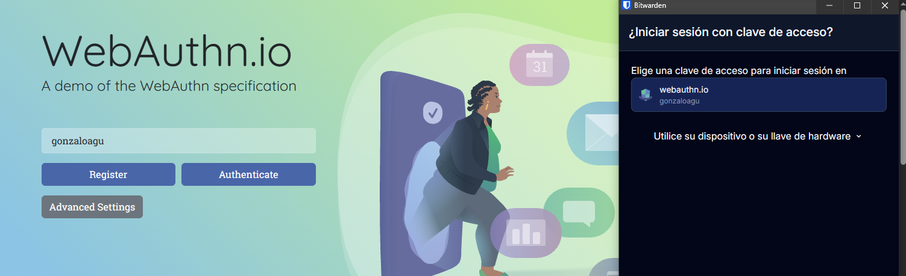
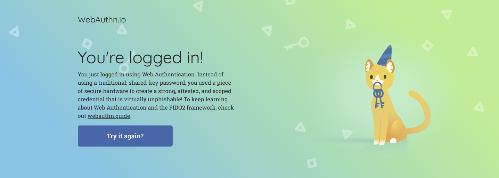

# Trabajo Práctico 7 — Autenticación

## Parte A — Cómo se guarda una contraseña

```bash
echo -n "Primavera2026" | sha256sum
mkpasswd -m bcrypt "Primavera2026"
mkpasswd -m bcrypt "Primavera2026"
```

### Consigna A1

*Corré `mkpasswd -m bcrypt` dos veces con la misma contraseña. ¿Por qué dan resultados distintos? (pista: la sal).*

El resultado es distinto porque al generar cada hash, se le concatena una string aleatoria llamada **salt**, lo cual permite que múltiples contraseñas en una base de datos.



### Consigna A2

*Explicá por qué un `sha256sum` no sirve para almacenar contraseñas, aunque sea un hash. Relacionalo con "el hash tiene que ser lento".*

La generación del hash debe ser lento para que no sea viable computacionalmente ejecutar ataques de fuerza bruta sobre una base de datos filtrada con hashes de contraseñas. Además, sha256sum no tiene salt, con lo cual no se estaría protegido de ataques con rainbow tables.

### Consigna A3

*¿Qué agrega Argon2 sobre bcrypt? (pista: costo de memoria).*

Además de ser costoso en tiempo de ejecución, Argon2 es costoso en memoria. Esto previene ante ataques de fuerza bruta donde se utiliza una gran cantidad de GPUs en paralelo.

---

## Parte B — Crackeo: débil vs. fuerte

```bash
mkpasswd -m bcrypt "123456"        > hashes.txt
mkpasswd -m bcrypt "correct horse battery staple" >> hashes.txt
john --format=bcrypt --wordlist=/usr/share/wordlists/rockyou.txt hashes.txt
john --show --format=bcrypt hashes.txt
```

### Consigna B1

*¿Cuál de las dos cayó y cuál no? ¿Por qué la longitud le gana a la complejidad? (relacionalo con la recomendación de NIST 800-63B-4).*

John rápidamente, en menos de 1 segundo, encontró un hash de la contraseña "123456"



Sin embargo, siguió su ejecución un tiempo y no encontró ninguna mas.

Esto tiene que ver con la recomendación de NIST 800-63B-4, donde se le recomienda a los servicios que exijan contraseñas de al menos 15 caracteres.




### Consigna B2

*¿Por qué la sal no impide el crackeo por diccionario, pero sí las rainbow tables?*

Porque la salt no impide que se prueben los hashes por fuerza bruta. Lo único que hace es evitar que se puedan encontrar "hashes conocidos", los cuales se encuentran en las rainbow tables y permiten encontrar las contraseñas más típicas de los usuarios.

---

## Parte C — Segundo factor: TOTP

```bash
SECRET="JBSWY3DPEHPK3PXP"
oathtool --totp --base32 "$SECRET"
# Esperar más de 30 s
oathtool --totp --base32 "$SECRET"
```

### Consigna C1

*Mostrá dos códigos calculados con más de 30 s de diferencia: ¿cambió? ¿Por qué?*

Los códigos cambian porque TOTP utiliza la hora junto al secreto como semilla para generar los números de autenticación. 



### Consigna C2

*Si un atacante intercepta un código TOTP, ¿le sirve un minuto después? Justificá.*

No. Para que le sirva, el atacante debería encontrar una manera de rebobinar la hora del servidor de autenticación.

### Consigna C3

*¿Qué diferencia a HOTP de TOTP en el "contador"?*

HOTP no utiliza la hora. Genera los numeros en base a un contador que se incrementa sólo cuando se utiliza. Esto significa que si un atacante intercepta un número generado por HOTP, lo podría utilizar para acceder a la cuenta si el usuario legítimo, por el motivo que sea, no lo hace primero.

---

## Parte D — Passkeys y comparación de factores

### Registro en webauthn.io

*Entrá a la demo oficial https://webauthn.io desde tu navegador y registrá y usá una passkey (huella, PIN del dispositivo o llave). Documentá el flujo con capturas.*

Al registrarme, abrió mi gestor de contraseñas Bitwarden.



Desde Bitwarden guardé la passkey, y la página indicó que el proceso está completado y que intente autenticarme.



Al darle a Authenticate, se me abrió nuevamente Bitwarden para que elija la passkey.



Luego de elegir la passkey, se me detectó como un inicio de sesión correcto.



### Consigna D1

*¿En qué momento se usó tu clave privada y qué guardó el servidor? ¿Por qué una web de phishing no podría reutilizar tu passkey?*

Mi gestor de contraseñas generó un par de claves, guardó la privada y le envió al servidor la pública, quien la guardó.
Una web de phishing no puede obtener mi passkey (clave privada) porque no la sé. El usuario no puede sin querer ingresar algo que desconoce. Y los gestores de passkeys verifican si el dominio que está solicitando la passkey es correcta.

### Consigna D2

*Completá una tabla comparando contraseña · TOTP · passkey según: ¿se puede phishear?, ¿se reutiliza?, ¿se filtra desde el servidor?*

| Factor | ¿Se puede phishear? | ¿Se reutiliza? | ¿Se filtra desde el servidor? |
|--------|---------------------|----------------|-------------------------------|
| Contraseña | Si | Si | Sí, aunque suele ser en forma de hash |
| TOTP | Si, aunque el atacante debe ser rápido | No | Se podría filtrar la semilla secreta |
| Passkey | No | No | No |

<!-- Completar y citar fuentes -->

### Consigna D3

*Explicá la diferencia entre OAuth 2.0 y OpenID Connect con el botón "iniciar sesión con Google": ¿cuál prueba quién sos?*

Con el botón "iniciar sesión con Google" conviven dos protocolos que suelen confundirse. **OAuth 2.0** (RFC 6749 [1]) es un framework de **autorización/delegación**: permite que una aplicación acceda a recursos del usuario alojados en otro servicio, sin conocer su contraseña, mediante un *access token*. Ese token indica **qué puede hacer** la aplicación (por ejemplo, leer el calendario), pero no prueba **quién es** la persona: OAuth 2.0 no es un mecanismo de autenticación por sí mismo.

**OpenID Connect (OIDC)** es una capa de **autenticación** construida sobre OAuth 2.0 [2]. Además del *access token*, agrega un **ID Token**: un JWT firmado por el proveedor de identidad (Google) que contiene *claims* como el emisor (`iss`), el identificador del usuario (`sub`), la audiencia (`aud`), la expiración (`exp`) y el momento de la autenticación. La aplicación valida la firma y esos campos y así obtiene una identidad verificada; el `sub` es el identificador estable de la cuenta.

Por lo tanto, la parte que **prueba quién sos es OpenID Connect**, a través del ID Token. OAuth 2.0 solo aporta el mecanismo de delegación y los tokens de acceso; usarlo "pelado" para iniciar sesión es el antipatrón clásico, porque un *access token* no está pensado como prueba de identidad. Regla mnemotécnica: **OAuth = qué podés hacer; OIDC = quién sos**.

---

## Referencias

1. IETF. *RFC 6749 — The OAuth 2.0 Authorization Framework* (2012). https://www.rfc-editor.org/rfc/rfc6749
2. OpenID Foundation. *OpenID Connect Core 1.0* (2014). https://openid.net/specs/openid-connect-core-1_0.html
