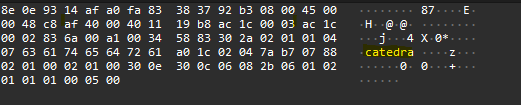
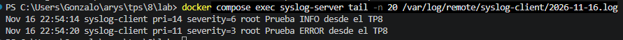

# Trabajo Práctico 8 — Monitoreo

> El laboratorio se resuelve sobre Docker en `lab/` (ver `lab/README.md`). Cada
> comando `docker compose ...` reemplaza la VM que indicaba la consigna.

## Parte A — SNMP

### A.1 Consultar un agente

```bash
cd lab
docker compose --profile snmp up -d --build

# PowerShell (host Windows)
docker compose exec snmp-client snmpwalk  -v2c -c catedra snmp-agent | Select-Object -First 20
# Bash o portable (pipe dentro del contenedor)
docker compose exec snmp-client sh -c "snmpwalk -v2c -c catedra snmp-agent | head -20"

docker compose exec snmp-client snmpget   -v2c -c catedra snmp-agent sysDescr.0
docker compose exec snmp-client snmpget   -v2c -c catedra snmp-agent sysUpTime.0
```

#### Consigna A.1.1

*¿Qué información expone `snmpwalk`? Mostrá 5 OIDs y qué representan.*

[alt](./assets/captura-solucion-2026-11-15-17-23-29.png)

| OID | Nombre | Qué representa |
|----------|------------|--------------------|
| `1.3.6.1.2.1.1.1.0` | `SNMPv2-MIB::sysDescr` | Descripción textual del sistema (SO, versión y arquitectura) |
| `1.3.6.1.2.1.1.3.0` | `SNMPv2-MIB::sysUpTime` | Tiempo transcurrido desde la última inicialización del agente |
| `1.3.6.1.2.1.1.4.0` | `SNMPv2-MIB::sysContact` | Contacto administrativo del nodo |
| `1.3.6.1.2.1.1.5.0` | `SNMPv2-MIB::sysName` | Nombre administrativo del nodo |
| `1.3.6.1.2.1.1.6.0` | `SNMPv2-MIB::sysLocation` | Ubicación física del nodo |

Los OIDs y nombres corresponden al grupo `system` de `SNMPv2-MIB` [1].

#### Consigna A.1.2

*Identificá el **manager**, el **agente** y la **MIB** en lo que hiciste.*

El rol de manager lo comple el contenedor snmp-client, donde se ejecutan los comandos snmpwalk y snmpget. El agente es el contenedor snmp-agent, que corre el demonio snmpd y responde en el puerto UDP 161. El MIB es el conjunto de definiciones que describe los objetos y sus OIDs. El manager la usa para traducir los OIDs a nombres como sysDescrt e interpretar los valores.

### A.2 Por qué v2c es inseguro

```bash
docker compose exec snmp-client /scripts/snmp-capture.sh
# Abrir lab/captures/snmp.pcap en Wireshark y filtrar por "snmp"
```

#### Consigna A.2.1

*¿Pudiste **ver la community string "catedra"** en texto plano en la captura? Mostralo.*

Sí. Efectivamente se puede leer en texto plano la community string, en la solicitud get.



#### Consigna A.2.2

*Explicá por qué esto es un problema grave y cómo lo resuelve **SNMP v3** (USM: autenticación + cifrado).*

Un intruso podría estar sniffeando y obtener esta información, pudiendo acceder al agente con todos los permisos que nosotros le hayamos configurado. SNMP v3 aporta autenticación (HMAC) y cifrado mediante el User-based Security Model (USM), además de protección anti-replay. [3]

---

## Parte B — Syslog

```bash
docker compose --profile syslog up -d

docker compose exec syslog-client logger --server syslog-server --port 514 --udp --priority user.info "Prueba INFO desde el TP8"
docker compose exec syslog-client logger --server syslog-server --port 514 --udp --priority user.err  "Prueba ERROR desde el TP8"

docker compose exec syslog-server tail -n 20 /var/log/remote/syslog-client/[FECHA ACTUAL en YYYY-MM-DD].log
```

```bash
# Opcional: centralización con TLS/6514
docker compose -f compose.yaml -f compose.tls.yaml --profile syslog-tls up -d --build
docker compose exec syslog-client-tls logger -p user.info "Prueba INFO por TLS desde el TP8"
docker compose exec syslog-server-tls tail -n 20 /var/log/remote/syslog-client-tls/*.log
```

#### Consigna B.1

*Ubicá tus dos mensajes y su **severidad**. Enumerá la escala 0–7.*



| Nivel | Nombre | Significado |
|-------|--------|-------------|
| 0 | Emergency | Sistema inutilizable |
| 1 | Alert | Se debe tomar acción de inmediato |
| 2 | Critical | Condiciones críticas en el sistema |
| 3 | Error | Condiciones de error |
| 4 | Warning | Condiciones de advertencias (posibles problemas a futuro) |
| 5 | Notice | Condición normal, pero significativa |
| 6 | Informational | Mensajes informativos generales |
| 7 | Debug | Mensajes detallados para diagnóstico, utilizados por desarrolladores |

#### Consigna B.2

*Un log solo vive en el equipo. Explicá por qué **centralizarlo** (y protegerlo con TLS/6514) es clave contra el **borrado de huellas** (Unidad 3).*

Con logs centralizados y protegidos, el borrado es mucho más difícil —la evidencia ya salió del equipo comprometido— y, además, permite correlacionar eventos de toda la red. El monitoreo centralizado es la contramedida directa al borrado de huellas. [4]

---

## Parte C — Observabilidad (Prometheus + Grafana)

```bash
docker compose --profile obs --profile snmp --profile obs-snmp up -d --build

# Prometheus: http://localhost:9090  ->  consultar la métrica up
# Grafana:    http://localhost:3000  ->  admin/admin, dashboard "TP8 - Observabilidad"
```

#### Consigna C.1

*Mostrá la métrica `up` en Prometheus. ¿Qué representa?*

[](./assets/captura-solucion-2026-11-16-20-11-20.png)

#### Consigna C.2

*Relacioná este stack con SNMP: ¿qué rol cumple Prometheus (recolección) y cuál Grafana (visualización)?*

Prometheus cumple el rol de **recolección y almacenamiento**: en el modelo *pull*
consulta (*scrape*) cada target a intervalos regulares, guarda las muestras como
series temporales y evalúa reglas de alerta [6]. Es el equivalente cloud-native del
**manager/NMS** de SNMP: donde el manager sondea al agente por OIDs de la MIB,
Prometheus sondea endpoints HTTP `/metrics`; el `snmp-exporter` actúa como puente y
traduce las consultas SNMP al formato que Prometheus entiende (por eso el job `snmp`
figura como target en `prometheus.yml:14-27`). Grafana es solo la capa de
**visualización**: se conecta a Prometheus como *data source* y arma dashboards y
gráficos, sin recolectar ni almacenar por sí misma [7]. En conjunto reproducen el
ciclo de SNMP —recolectar, almacenar, graficar y alertar—, pero sobre métricas de
series temporales y con dashboards [5].

#### Consigna C.3

*Nombrá los **tres pilares** de la observabilidad y qué herramienta viste de cada uno.*

Los tres pilares son **métricas**, **logs** y **trazas** [5]. En el laboratorio se
vieron los dos primeros: métricas con **Prometheus + Grafana** (más `node-exporter` y
`snmp-exporter` como fuentes) y logs con **Syslog** (`rsyslog`, UDP 514 y TLS/6514)
[4][5]. No se practicaron trazas; el estándar emergente para instrumentarlas es
**OpenTelemetry (OTel)** [5].

| Pilar | Herramienta vista |
|-------|-------------------|
| Métricas | Prometheus + Grafana (con `node-exporter` y `snmp-exporter` como fuentes) [6][7] |
| Logs | Syslog / `rsyslog` (centralización, UDP 514 y TLS 6514) [4] |
| Trazas | No se practicó; el estándar es OpenTelemetry (OTel) [5] |

---

## Parte D — Cierre: del dato a la defensa

#### Consigna D.1

*De todo lo que monitoreaste (SNMP, logs, métricas), ¿qué alimentarías a un **SIEM** y para qué? Relacionalo con el **IDS** de la Unidad 5.*

A un **SIEM** le alimentaría las tres fuentes que vimos: (a) las **métricas** de
Prometheus —estado `up`, CPU/memoria de `node-exporter`, salud del agente vía
`snmp-exporter`—, (b) los **logs** centralizados de Syslog y (c) los **eventos SNMP**
del agente. El SIEM centraliza y **correlaciona** esas señales para detectar
incidentes, sumando también flujos e IDS como fuentes [8]. El **IDS** de la Unidad 5
observa tráfico o host y **alerta** ante actividad sospechosa [10]; sus alertas son
una fuente más que el SIEM combina con logs y métricas. El valor está en la
correlación: una transferencia anómala (métrica) **más** una alerta del IDS **más**
un login inusual en Syslog pueden, juntas, disparar una detección que por separado
pasaría inadvertida [8]. En el laboratorio, el Syslog centralizado es justamente lo
que aporta la evidencia correlacionable y difícil de borrar [4].

#### Consigna D.2

*Explicá con tus palabras cómo el monitoreo cierra el ciclo **detectar → responder → mejorar** (seguridad como proceso, Unidad 1).*

El monitoreo es la fase que **sostiene** al resto del ciclo: sin detección no hay
respuesta, y sin evidencia no hay investigación ni mejora [9]. En **detectar**, las
señales de SNMP, logs, métricas e IDS llegan al SIEM, que las correlaciona y alerta.
En **responder**, con la alerta y la evidencia ya centralizada (Syslog con TLS) se
contiene y erradica el incidente siguiendo el ciclo de respuesta de NIST SP 800-61
[12]. En **mejorar**, se aprende del incidente y se ajustan reglas de detección,
umbrales y controles, volviendo a detectar: es un ciclo continuo. Esto encarna la
idea de la Unidad 1 de que la seguridad **no es un producto, sino un proceso** [11].

---

## Referencias

<!-- Citar todas las fuentes usadas -->

1. IETF. *RFC 3418 — Management Information Base (MIB) for the Simple Network Management Protocol (SNMP)* (2002). https://www.rfc-editor.org/rfc/rfc3418
2. RFC 1157 — A Simple Network Management Protocol (SNMPv1).
3. Unidad 8 — Herramientas de Monitoreo - SNMP - Arquitectura - Las versiones y la seguridad
4. Unidad 8 — Herramientas de Monitoreo - Syslog - Centralización
5. Unidad 8 — Herramientas de Monitoreo - La observabilidad moderna (tres pilares de la observabilidad)
6. Prometheus. *Documentation*. https://prometheus.io/docs/
7. Grafana Labs. *Grafana Documentation*. https://grafana.com/docs/
8. Unidad 8 — Herramientas de Monitoreo - SIEM y monitoreo de seguridad
9. Unidad 8 — Herramientas de Monitoreo - El cierre del ciclo
10. Unidad 5 — Firewall, IDS y Honeypot (detección vs. prevención, IDS/IPS)
11. Unidad 1 — Conceptos de Seguridad (seguridad como proceso)
12. NIST SP 800-61 Rev. 3 — *Incident Response Recommendations*. https://csrc.nist.gov/pubs/sp/800/61/r3/final